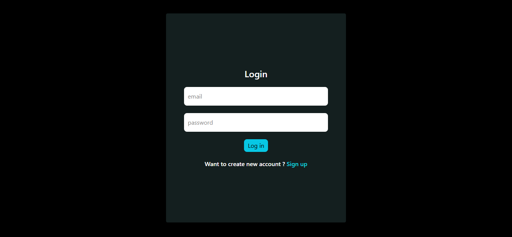
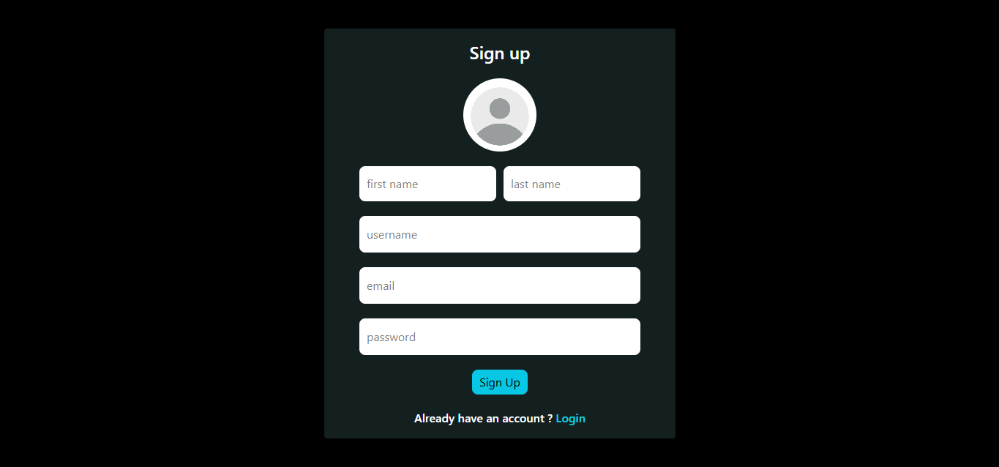
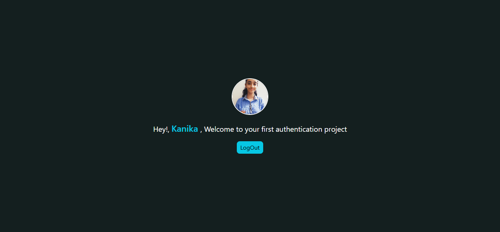

# Web Development Journey 🚀

Welcome to my **Web Development Course Repository**! This repository documents my journey of learning web development through hands-on practice, coding exercises, and projects.

I'm a **B.Tech CSE student (2027 batch)** building my skills in frontend development, backend development, databases, and full-stack web applications.

## 🛠️ Tech Stack

### Frontend

- HTML5
- CSS3
- JavaScript (ES6+)
- DOM Manipulation
- React.js
- Tailwind CSS
- Responsive Web Design

### Backend

- Node.js
- Express.js
- REST APIs
- Middleware and HTTP Status Codes
- Authentication using JWT
- Cookie-based Authentication

### Database

- MongoDB
- Mongoose

### Tools

- Git & GitHub
- VS Code
- npm

## 📂 Repository Structure

| Folder            | Description                                 |
| ----------------- | ------------------------------------------- |
| `HTML/`           | HTML fundamentals and practice              |
| `CSS/`            | Styling, layouts, and CSS practice          |
| `JAVASCRIPT/`     | JavaScript concepts and exercises           |
| `REACT/`          | React learning and practice                 |
| `TailwindCSS/`    | Utility-first CSS styling                   |
| `NODE.js/`        | Node.js fundamentals and server development |
| `MongoDB/`        | Database concepts and practice              |
| `AUTHENTICATION/` | Full-stack authentication project           |

## 💻 Projects & Practice

Some of the projects and exercises included in this repository are:

- Hacking Simulator
- Business Name Generator
- Faulty Calculator
- Random Color Generator using DOM
- CSS Layouts and Variables
- React practice projects
- Node.js and Express server exercises
- Frontend and backend integration
- **Authentication Web Application**

## 🔐 Authentication Project

A full-stack authentication application built with React,
Node.js, Express.js and MongoDB.

**Key concepts being developed:**

- User signup and login
- Password hashing using bcrypt
- JWT-based authentication
- HTTP-only cookies
- Protected API routes using authentication middleware
- User data retrieval from MongoDB
- Frontend-backend communication using Axios
- CORS configuration and credential handling

**Technologies:** React.js, Node.js, Express.js, MongoDB, Mongoose, JWT, bcrypt, Axios, and cookies.

### Login

### Signup

### Home

## 📈 Learning Progress

- [x] HTML and CSS fundamentals
- [x] JavaScript fundamentals and DOM manipulation
- [x] React.js fundamentals and practice
- [x] Tailwind CSS
- [x] Node.js and Express.js fundamentals
- [x] MongoDB fundamentals
- [x] Connecting frontend with backend
- [ ] Complete and thoroughly test the authentication workflow
- [ ] Build and deploy more full-stack applications
- [ ] Strengthen Data Structures and Algorithms
- [ ] Learn advanced backend concepts and improve application security

## 🎯 Goals

- Build responsive and user-friendly web applications.
- Develop strong frontend and backend skills.
- Understand authentication, APIs, and database integration.
- Build practical projects that solve real problems.
- Prepare for software development internships and opportunities.

## 👩‍💻 About Me

I'm Kanika Khurana, a B.Tech Computer Science student from the **2027 batch**, continuously learning and building projects to strengthen my software development skills.

I believe in learning by building, debugging, and improving one project at a time.

**Current focus:** React.js, Node.js, Express.js, MongoDB, authentication, and full-stack development.

---

⭐ Thanks for visiting my repository! Feel free to explore my projects and follow my learning journey.
